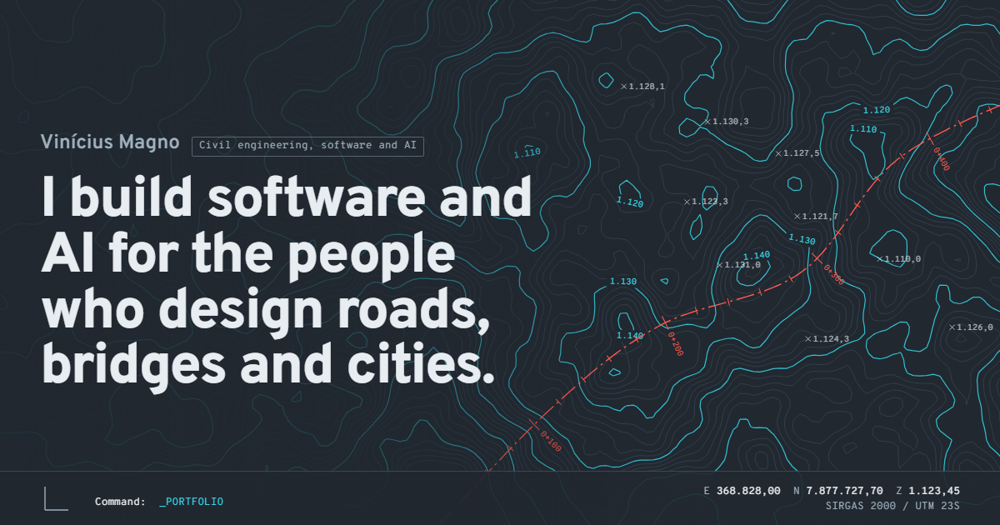

# viniciusmagno.com

<a href="https://viniciusmagno.com/en/"></a>

Source of my portfolio, live at **[viniciusmagno.com](https://viniciusmagno.com)** (Portuguese) and **[/en/](https://viniciusmagno.com/en/)** (English).

The concept is an engineering drawing set. The hero is CAD model space; scroll down and the page becomes the plotted sheet. Everything is hand-written: no framework, no dependencies, no template.

## What’s in here

- **Live terrain** ([`public/assets/terrain.js`](public/assets/terrain.js), 361 lines). Seeded Perlin fBm with a regional slope → marching squares on an 8 px grid → contour lines every 2 m, with index contours every 10 m labelled along the line. A Catmull-Rom road centerline gets stations every 20 m, spot heights get their × marks, and an AutoCAD-style crosshair reads out SIRGAS 2000 / UTM 23S coordinates and the elevation under the cursor. On load the contours draw in elevation order, like a plotter pass; `prefers-reduced-motion` gets the final frame.
- **Engineering figures** ([`src/figures.mjs`](src/figures.mjs)). Each project diagram is a hand-drawn SVG: ink is `currentColor`, the discipline color is a CSS variable, and they use real drafting conventions such as dimension lines, leaders and hatches.
- **Drafting vocabulary as UI.** The numbers live in a bill of quantities, projects in a drawing list, the career in a longitudinal profile, the stack in a layer properties manager, and the footer in a title block. A command line in the status bar navigates the page (`PROJECTS`, `CONTACT`, `HELP`).
- **Static bilingual build** ([`build.mjs`](build.mjs)). One content file with PT/EN pairs is pre-rendered to HTML for both languages, with hreflang, JSON-LD and a sitemap. The share images are rendered by headless Chrome with the same terrain engine.

## Run it

```bash
npm run preview   # build to dist/ and serve on http://localhost:4321
npm run build     # build only
node og/og.mjs    # regenerate the share images (needs the preview server)
```

Node 20+. There is nothing to `npm install`.

## Layout

| Path | What |
|:--|:--|
| `src/content.mjs` | all the copy, in PT + EN pairs |
| `src/render.mjs` | HTML template for both languages |
| `src/figures.mjs` | SVG project figures |
| `public/assets/terrain.js` | contour engine and crosshair |
| `public/assets/styles.css` | design tokens and layout |
| `github-profile/` | my GitHub profile README and its banner generator |
| `deploy.mjs` | build + upload over SSH (destination in an untracked `deploy.config.json`) |

Maintenance notes in Portuguese: [MANUTENCAO.md](MANUTENCAO.md).

## License

The code is published for reference. The text, photo and project descriptions are © Vinícius Magno; please don’t reuse them.
